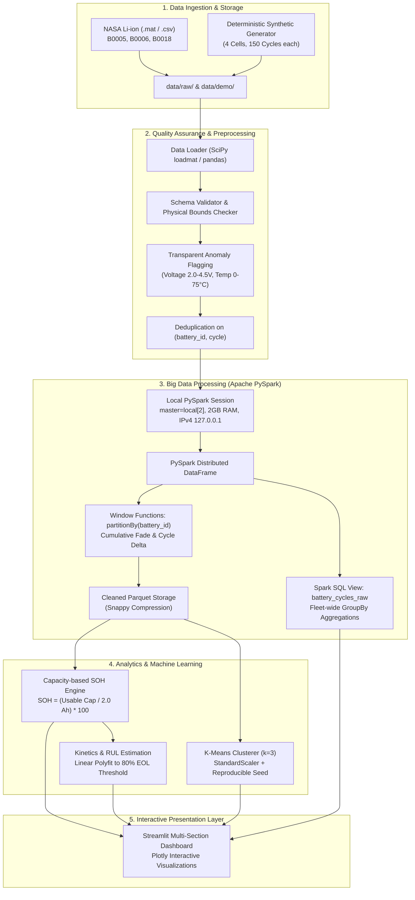

# EVGuard System Architecture

## 1. Overview
**EVGuard** is a Big Data and machine learning framework designed for Electric Vehicle (EV) lithium-ion battery health diagnostics and degradation prognosis. It processes electrochemical charge/discharge telemetry, calculates capacity-based **State of Health (SOH)**, evaluates Remaining Useful Life (RUL), and categorizes aging regimes using **K-Means clustering**.

The platform is strictly optimized for local CPU execution on commodity dual-core hardware (Intel Core i3, 12 GB RAM, Windows 64-bit) without relying on GPU hardware, cloud clusters, or external databases.

---

## 2. End-to-End Pipeline Architecture



---

## 3. Hardware Optimization Strategy

| System Parameter | Hardware Constraint | Optimization Applied in EVGuard |
|---|---|---|
| **CPU** | Intel Core i3-1005G1 (2 Cores, 4 Threads) | `spark.master("local[2]")`, `spark.sql.shuffle.partitions = "2"` |
| **RAM** | 12 GB Total Physical Memory | `spark.driver.memory = "2g"`, lazy evaluation, avoid large in-memory `collect()` |
| **Operating System** | Windows 64-bit | `spark.driver.host = "127.0.0.1"`, `spark.driver.bindAddress = "127.0.0.1"` |
| **Java Environment** | Adoptium JDK 17 Hotspot | Automatic `JAVA_HOME` binding to JDK 17 to bypass reflection/illegal-access restrictions |
| **Hadoop Native IO** | Windows `winutils.exe` absence | `spark.hadoop.fs.file.impl = org.apache.hadoop.fs.RawLocalFileSystem` + PyArrow fallback serialization |
| **Storage Engine** | Local SSD (~192 GB free) | Columnar Apache Parquet with Snappy compression |

---

## 4. Software Design & Modularization

```
src/evguard/
├── analytics/    # SOH formulas, health stage classification, degradation rate, RUL
├── bigdata/      # SparkSession factory, Spark SQL queries, PySpark Window transformations
├── data/         # CSV & MATLAB .mat loader, deterministic synthetic generator, schema validator
├── models/       # StandardScaler + KMeans clustering, elbow curve, silhouette evaluation
└── utils/        # Paths, physical bounds config, logging
```

All application logic is strictly separated into reusable Python packages with unit tests in `tests/`, ensuring code maintainability and college-level academic rigor.
